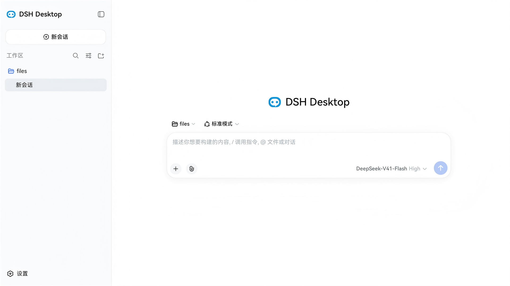

[中文](./README_zh.md) | English

# DSH Desktop

> An Electron shell for [DeepSeek Harness](https://github.com/deepseek-ai/deepseek-harness) that runs the **official, unmodified** dsh Web UI — on Windows, Linux and macOS. Also the reference implementation if you want to build your own shell.

<p align="center">
  
</p>
<p align="center">
  <sub><b>Real capture — no mockup.</b> The official dsh Web UI inside the shell. This frame comes from the
  <a href="https://github.com/fellow99/dsh-desktop-hos">HarmonyOS edition</a> (same shell, same Web UI, same data plane),
  because it is the edition with a ready device shot; the desktop build loads the identical, unmodified UI.</sub>
</p>

<p align="center">
  <a href="https://github.com/fellow99/dsh-desktop/releases/latest"></a>
  
  
  
  
</p>

**Status** `0.2.1` — packaging works on all three platforms; tray, native notifications, native window frame, clipboard image paste, window-state persistence and F11 are in. **No auto-update, no code signing, no store distribution yet.**

## Why this shell

Three decisions, and they are the whole design:

| Decision | What it means |
|---|---|
| **Zero upstream changes** | The renderer loads `dsh web`'s own SPA same-origin. Only three idempotent patches are applied, all of them Electron-compatibility toggles (HMR off, native directory picker off, onboarding steps off) — no fork, no re-implementation of the UI. |
| **No CORS, no auth dance, no custom protocol, no IPC carrier** | The dsh Host starts *inside the Electron main process*, and its webserver serves both `dist/` and `/api` on one bound port. The window is a browser pointed at `http://127.0.0.1:<port>/`. |
| **Linux is a first-class target** | `.deb` and `.rpm` ship next to the Windows installer and the macOS DMG. Most dsh desktop shells stop at Windows/macOS. |

## Features

| Capability | State |
|---|---|
| System tray (quit / restore) | ✅ |
| Native notifications, subscribed to dsh session events | ✅ |
| Native window frame (system min / max / close) | ✅ |
| Clipboard image paste | ✅ |
| Window state persistence (maximized / bounds restored) | ✅ |
| F11 fullscreen | ✅ |
| Global shortcut · launch at login · multiple windows | ⏸ deferred |

The native file picker reuses dsh's standard in-app directory browser (one of the three patches), so no OS dialog is involved.

## Download

| Platform | Artifact | Notes |
|---|---|---|
| Windows x64 | [Setup.exe](https://github.com/fellow99/dsh-desktop/releases/latest) · portable ZIP | Squirrel installer, **unsigned** |
| Linux x64 | `.deb` · `.rpm` · ZIP | Debian/Ubuntu and Fedora/RHEL |
| macOS arm64 | `.dmg` · ZIP | **Unsigned** — Gatekeeper needs a manual allow |

**HarmonyOS edition (2in1 / tablet)** lives in a separate repo — [dsh-desktop-hos](https://github.com/fellow99/dsh-desktop-hos): same shell architecture and the same unmodified Web UI, with the Electron runtime swapped for the Electron-on-HarmonyOS one. There is no consumer installer yet (AppGallery track).

Everything here is local `npm run make` output: no signing, no notarization, no auto-update. If that matters to you, build it yourself — see [Development](#development).

## Compatibility

| Shell | dsh (upstream tag) | Electron | Platforms | Verified |
|---|---|---|---|---|
| `0.2.1` | `dsh-v0.2.1-rc.2` | `43.0.0` | Windows x64 · Linux x64 · macOS arm64 | artifacts produced by `npm run make`; runtime exercised via `npm start` |

Upstream dsh is a **developer preview** and ships breaking changes. This shell pins one tag at a time: bumping it means adding `patches/<new-tag>/` and updating the pin in `scripts/build-dsh.mjs`.

## Also a reference implementation

Most dsh desktop shells are products. This one is deliberately documented like a specimen, so the working parts can be copied into your own shell:

- `specs/` — as-built specs: host, window, tray, notifications, lifecycle, preload, app entry, desktop profile, plugin market
- `patches/dsh-v0.2.1-rc.2/` — the three patches, each with its reason
- `AGENTS.md`, `docs/000-产品概念设计.md` — architecture and working conventions
- `scripts/build-dsh.mjs` · `collect-dsh.mjs` · `fetch-runtime.mjs` — reproducible build, artifact collection, bundled-runtime channel

## How it works

```
Electron main process (Node.js, also hosts the dsh Host)
  runProfile('desktop', ['--port','0']) → { ctx, port, shutdown }
    ├─ webserver   127.0.0.1:<free port> — serves dist + /api
    ├─ apiProxy    RPC gateway
    └─ connection  /api + WebSocket
  renderer: loadURL('http://127.0.0.1:<port>/')   ← same-origin
```

No preload bridge, no window-control channel: the renderer uses dsh's existing `WebApiClient` (HTTP uplink + WebSocket downlink) against the same origin. Tray and notifications are produced in the main process by subscribing to `ctx` session events.

## Tech stack

- **Electron** + **Electron Forge** (scaffolding & packaging)
- **deepseek-harness** (`dsh`, a sibling directory of this project, not a submodule, referenced as `../deepseek-harness`; consumed via local source reference) — current build is based on **`dsh-v0.2.1-rc.2`**; its patches live in `patches/dsh-v0.2.1-rc.2/`
- **dsh-market** (a sibling directory, referenced as `../dsh-market`; the built-in visual plugin marketplace — npm package `dshmarket`)
- **TypeScript**

## Development

### Integration approach

- **Source reference**: dsh lives in a sibling directory (`../deepseek-harness`, not a submodule); we consume its build artifacts. The plugin marketplace dsh-market likewise lives in a sibling directory (`../dsh-market`, npm package `dshmarket`); its build output is materialized into dsh's `node_modules/dshmarket` and bundled as a built-in plugin. Both siblings are required for a build.
- **Host integration**: `src/main/host.ts` dynamically imports dsh's `runProfile` (apps/cli build artifact), hosting the dsh Host in the main process (webserver bound to `127.0.0.1:<free port>`), returning a `{ ctx, shutdown, port, url }` handle.
- **Same-origin data plane**: the renderer does `loadURL(http://127.0.0.1:<port>/)` to load the dsh Web UI same-origin, reusing `WebApiClient` (HTTP uplink + WebSocket downlink) — zero CORS, zero auth, zero new carrier.
- **desktop profile**: `profiles/desktop/` (`dsh.profile.bundles = [dsh-base, dsh-web-app]`, with cordis.patch.yml overriding `web-runtime.printUrl: false`), copied to `$DSH_HOME/profiles/desktop` at runtime.

### Build process (with patches)

dsh depends on Node internal APIs (HMR, native directory dialog) that are unavailable under Electron, so three patches must be applied before building. One command does it all (idempotent — `--reverse --check` detects already-applied and skips). It also builds the sibling `../dsh-market` plugin marketplace:

```bash
npm run build:dsh   # ① git apply both patches under patches/ → ② pnpm install (if node_modules missing) → ③ build:lib:host + build:lib:client + build:web → ④ build ../dsh-market (npm install if needed + npm run build)
```

**Prerequisite — sibling source checkouts.** This project consumes both `deepseek-harness` and `dsh-market` as sibling directories (not submodules). Before building, clone them next to this project:

```bash
# dsh: pinned tag = dsh-v0.2.1-rc.2 (also set in .github/workflows; matches patches/dsh-v0.2.1-rc.2/)
git clone --branch dsh-v0.2.1-rc.2 https://github.com/deepseek-ai/deepseek-harness.git ../deepseek-harness
git clone --branch v1.26.0             https://github.com/dsh-market/dsh-market.git         ../dsh-market
```

`collect-dsh.mjs` hard-fails if `../dsh-market` is missing (the packaged app bundles it as `dsh-dist/node_modules/dshmarket`); `build:dsh` warns and skips only the marketplace build if it is absent.

> **dsh version pin.** This project builds against deepseek-harness tag **`dsh-v0.2.1-rc.2`**. Patches are organized per dsh version (`patches/<dsh-tag>/`) and `scripts/build-dsh.mjs` pins `patches/dsh-v0.2.1-rc.2/` — when bumping to a new dsh tag, add a matching `patches/<new-tag>/` directory and update that pin.

| Patch | Purpose |
|---|---|
| `patches/dsh-v0.2.1-rc.2/dsh-disable-hmr.patch` | Adds a `DSH_DISABLE_HMR` switch to `runProfile`, skipping watch-only HMR (HMR depends on `--expose-internals`) |
| `patches/dsh-v0.2.1-rc.2/dsh-disable-native-picker.patch` | Forces directory-picker to use browse under Electron (the native dialog worker fails because it spawns electron.exe) |
| `patches/dsh-v0.2.1-rc.2/dsh-disable-welcome-notice.patch` | Drops the client's two `settings.onboarding` steps (the versioned internal-testing notice and the official-DeepSeek API-key prompt) so a first launch opens straight into the app, and updates `apply.client.spec.ts` to the shipped registration set |

> Electron compatibility root cause: dsh's loader obtains the Node internal ESM loader via the
> `node-addon-require-builtin` native module, which fails under Electron because Electron's V8
> lacks the `GetAlignedPointerFromEmbedderData` symbol; in development the loader falls back to
> default ESM import, resolved by `host.ts`'s `ensureWorkspaceLinks` linking workspace packages
> into dsh's root node_modules.

### Common commands

```bash
# This project's deps (npm: Electron / Forge / Vite)
npm install

# dsh deps (run inside ../deepseek-harness; pnpm workspace)
cd ../deepseek-harness && pnpm i

# Development: Vite build + launch Electron, main process hosts dsh Host and loads its Web UI
npm start

# Package: prepackage auto-collects (pnpm deploy materializes dsh artifacts into dsh-dist/, extraResource copies into resources/)
npm run package

# Distribution artifacts: Windows Squirrel installer / portable ZIP (makers in forge.config.ts)
npm run make
```

> The packaged output `out/DSH Desktop-win32-x64/` already includes dsh (lib + node_modules + web dist + profile); the exe runs dsh directly.

### Windows local build troubleshooting

On Windows with a restricted network (GitHub unreachable / Corepack limited), `npm run package` can hit three known pitfalls. Verified fixes:

**1. pnpm version mismatch (`pnpm --filter` resolves an old version)**

`deepseek-harness/package.json` pins `packageManager: pnpm@11.7.0`, but `corepack pnpm --filter <pkg> run ...` resolves a different version (e.g. 11.5.2) inside the sub-workspace and fails with `This project is configured to use 11.7.0 of pnpm`. `corepack enable` fails with `EPERM` under an nvm-managed Node (no write access to the node dir), so no pnpm shim is created; `pm-on-fail=ignore` in `.npmrc` also has no effect (the version check runs before config is read).

Fix — hand-roll a `pnpm.cmd` shim that calls corepack, place it in a user-writable dir and put it at the front of `PATH`:

```powershell
$shimDir = "C:\Users\$env:USERNAME\AppData\Local\pnpm-shim"
New-Item -ItemType Directory -Path $shimDir -Force | Out-Null
$corepackCmd = (Get-Command corepack.cmd).Source   # e.g. C:\Program Files\nodejs\corepack.cmd
Set-Content -Path (Join-Path $shimDir "pnpm.cmd") -Value @"
@ECHO off
GOTO start
:find_dp0
SET dp0=%~dp0
EXIT /b
:start
SETLOCAL
call "$corepackCmd" pnpm %*
"@ -Encoding ASCII
$env:PATH = "$shimDir;$env:PATH"    # prepend before every build
```

**2. `fetch-runtime` re-downloads (missing `.versions.json` stamp)**

`scripts/fetch-runtime.mjs` is idempotent via `runtime/.versions.json`. If the first download is interrupted (e.g. shell timeout), `runtime/node/` and `runtime/pnpm/` may be in place while the stamp is unwritten, so the next `npm run package` re-downloads Node + pnpm.

Fix — once `runtime/node/node.exe` and `runtime/pnpm/pnpm.exe` exist, hand-write the stamp to skip the download:

```powershell
# Must exactly match the `wanted` string the script builds (node / pnpm / platform / arch)
'{"node":"24.11.1","pnpm":"9.15.9","platform":"win32","arch":"x64"}' |
  Set-Content -Path .\runtime\.versions.json -Encoding ASCII -NoNewline
```

**3. Electron binary download `ETIMEDOUT` (GitHub blocked)**

The `electron-forge package` stage downloads the matching Electron binary from `github.com`; a restricted network yields `connect ETIMEDOUT`.

Fix — use the npmmirror China mirror (env vars apply to the current build process):

```powershell
$env:ELECTRON_MIRROR = "https://registry.npmmirror.com/-/binary/electron/"
$env:ELECTRON_CUSTOM_DIR = "v{{ version }}"
npm run package
```

> Combining all three (pnpm shim on PATH + stamp in place + Electron mirror) makes `npm run package` / `npm run make` run reliably on a restricted Windows box.

## Directory structure

This project, deepseek-harness (dsh), and dsh-market live in **sibling directories** (not submodules), integrated via source reference:

```
(sibling directories)
├── dsh-desktop/      # This project (Electron desktop shell)
│   ├── docs/                      # Product concept design
│   ├── specs/                     # Spec documents (as-built; see specs/README.md for index)
│   ├── patches/                   # dsh upstream patches (git apply, auto-applied by build:dsh)
│   │   ├── dsh-disable-hmr.patch
│   │   ├── dsh-disable-native-picker.patch
│   │   └── dsh-disable-welcome-notice.patch
│   ├── scripts/                   # Build scripts
│   │   ├── build-dsh.mjs          # apply patches + install deps + build dsh + dsh-market artifacts
│   │   ├── collect-dsh.mjs        # collect dsh artifacts into dsh-dist/ (pnpm deploy + materialize dshmarket)
│   │   └── fetch-runtime.mjs      # fetch portable Node + pnpm into runtime/ (packaged install channel)
│   ├── profiles/desktop/          # Custom desktop profile (dsh.profile.bundles + cordis.patch.yml)
│   ├── src/
│   │   ├── main/                  # Electron main process (= dsh Host host)
│   │   │   ├── index.ts           # single-instance lock → start host → create window → tray/notification/lifecycle
│   │   │   ├── host.ts            # runProfile('desktop') → { ctx, shutdown }; plugin link/resolve
│   │   │   ├── runtime.ts         # bundled Node/pnpm/dsh shim + PATH injection (market install channel)
│   │   │   ├── windows.ts         # BrowserWindow, loadURL(localhost), native frame/security
│   │   │   ├── window-state.ts     # persist maximized/bounds; restore on start; F11 fullscreen
│   │   │   ├── tray.ts            # system tray (quit/restore)
│   │   │   ├── notifications.ts   # subscribe to ctx session/event → native notifications
│   │   │   └── lifecycle.ts       # NO_PROXY/CA, crash handling
│   │   ├── preload/index.ts       # preload entry (no window-control bridge)
│   │   └── renderer/renderer.ts   # minimal renderer entry (fallback loading page)
│   ├── forge.config.ts            # Electron Forge config (extraResource copies dsh-dist + runtime)
│   ├── vite.*.config.ts           # Vite configs (main/preload/renderer)
│   ├── index.html                 # renderer entry (Forge Vite convention: at project root)
│   └── resources/                 # app icon, tray icon
│
├── deepseek-harness/              # The wrapped host (dsh, source reference, not a submodule)
│   ├── apps/                      # cli (dsh bin, profile-boot), web (Web frontend, build:web produces dist)
│   ├── packages/                  # host / client / core / session workspace packages
│   ├── vendor/                    # vendored cordis framework packages (cordis / loader / hmr / ...)
│   └── native/                    # landlock-run native module (Linux sandbox, cut in MVP)
│
└── dsh-market/                    # Plugin marketplace (source reference, not a submodule; npm pkg "dshmarket")
    ├── src/                       # host half (mounts /dsh-market/* routes, spawns `dsh plugin`)
    ├── client/                    # browser half (settings-page UI; built to client/client.js)
    ├── lib/                       # compiled host output (materialized into dsh-dist/node_modules/dshmarket)
    └── cordis.patch.yml           # loader insert declaration ({ id: dsh-market, name: dshmarket })
```

> **CI note:** GitHub Actions clones both siblings during the workflow (see
> `.github/workflows/ci.yml` and `release.yml` — `Checkout dsh (sibling)` and
> `Checkout dsh-market (sibling)`), because `actions/checkout` cannot place a second
> repository inside `$GITHUB_WORKSPACE`.

## Related docs

- [docs/000-产品概念设计.md](docs/000-产品概念设计.md) — product concept design (architecture, data flow, module breakdown, open questions)
- [specs/README.md](specs/README.md) — spec document index (project-level and module-level specs)
- [AGENTS.md](AGENTS.md) — AI agent working conventions

## References

- [deepseek-harness](https://github.com/deepseek-ai/deepseek-harness) (sibling directory `../deepseek-harness`) — the wrapped host; its `docs/` directory contains full architecture docs
- [dsh-market](https://github.com/dsh-market/dsh-market) (sibling directory `../dsh-market`) — the built-in visual plugin marketplace (npm package `dshmarket`), bundled via `collect-dsh.mjs`
- [opencode](https://github.com/sst/opencode) (desktop shell reference: `packages/desktop/`) — a similar "wrap an agent harness with Electron" use case
- [DSH Desktop website](https://fellow99.github.io/dsh-desktop-website/) — both editions, real device screenshots, and the architecture story in one page

## License

[MIT](LICENSE) © 2026 fellow99
