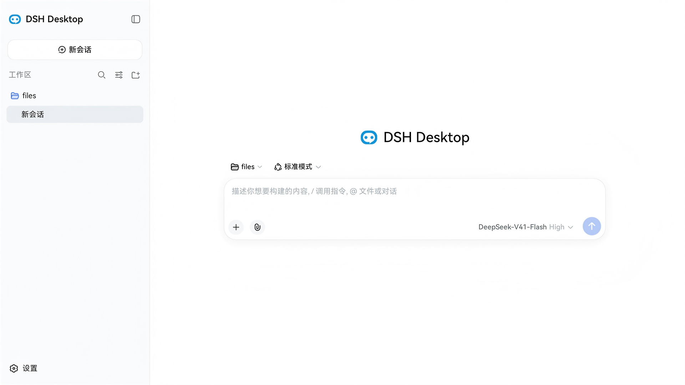

[English](./README.md) | 中文

# DSH Desktop

> 为 [DeepSeek Harness](https://github.com/deepseek-ai/deepseek-harness) 而做的 Electron 外壳：运行**官方、零改动**的 dsh Web UI，覆盖 Windows / Linux / macOS。同时它也是「如何自己造一个 dsh 外壳」的参考实现。

<p align="center">
  
</p>
<p align="center">
  <sub><b>真机实拍，不是效果图。</b>外壳里跑的就是官方 dsh Web UI。该帧取自
  <a href="https://github.com/fellow99/dsh-desktop-hos">鸿蒙版</a>（同一套外壳、同一套 Web UI、同一条数据面），
  因为目前只有鸿蒙版有现成的设备实拍；桌面版加载的界面与此完全一致。</sub>
</p>

<p align="center">
  <a href="https://github.com/fellow99/dsh-desktop/releases/latest"></a>
  
  
  
  
</p>

**状态** `0.2.0` —— 三端打包已跑通；托盘、原生通知、原生窗口框、剪贴板图片粘贴、窗口状态记忆、F11 全部到位。**暂无自动更新、无代码签名、不进商店。**

## 三个设计取舍

整个工程只有这三条决定：

| 取舍 | 含义 |
|---|---|
| **上游零改动** | 渲染进程同源加载 `dsh web` 自己的 SPA。只打三个幂等补丁，且都是 Electron 兼容开关（关 HMR、关原生目录选择器、关 onboarding 步骤）——不 fork，不重写界面。 |
| **无 CORS、无鉴权、无自定义协议、无 IPC 载体** | dsh Host 跑在 **Electron 主进程内**，它的 webserver 在同一个端口上同时服务 `dist/` 与 `/api`。窗口只是一个指向 `http://127.0.0.1:<port>/` 的浏览器。 |
| **Linux 是一等公民** | `.deb` 与 `.rpm` 与 Windows 安装器、macOS DMG 一起产出。多数 dsh 桌面壳只做 Windows/macOS。 |

## 能力

| 能力 | 状态 |
|---|---|
| 系统托盘（退出 / 唤回） | ✅ |
| 原生通知（订阅 dsh 会话事件） | ✅ |
| 原生窗口框（系统 min / max / close） | ✅ |
| 剪贴板图片粘贴 | ✅ |
| 窗口状态记忆（最大化 / 位置尺寸，重启恢复） | ✅ |
| F11 全屏切换 | ✅ |
| 全局快捷键 · 开机自启 · 多窗口 | ⏸ 暂缓 |

原生文件选择沿用 dsh 自带的应用内目录浏览（三个补丁之一），不弹系统对话框。

## 下载

| 平台 | 制品 | 说明 |
|---|---|---|
| Windows x64 | [Setup.exe](https://github.com/fellow99/dsh-desktop/releases/latest) · 免安装 ZIP | Squirrel 安装器，**未签名** |
| Linux x64 | `.deb` · `.rpm` · ZIP | Debian/Ubuntu 与 Fedora/RHEL |
| macOS arm64 | `.dmg` · ZIP | **未签名** —— 需在 Gatekeeper 里手动放行 |

以上全部是本地 `npm run make` 的产物：不签名、不公证、不自动更新。如果你在意这几点，就自己构建——见[开发](#开发)。

## 兼容矩阵

| 外壳版本 | dsh（上游 tag） | Electron | 平台 | 验证程度 |
|---|---|---|---|---|
| `0.2.0` | `dsh-v0.2.0-rc.2` | `43.0.0` | Windows x64 · Linux x64 · macOS arm64 | `npm run make` 已产出制品；运行时经 `npm start` 验证 |

上游 dsh 处于 **developer preview**，会有破坏性变更。本外壳一次只钉一个 tag：升级意味着新增 `patches/<新 tag>/` 并改 `scripts/build-dsh.mjs` 里的钉点。

## 它同时是一份参考实现

多数 dsh 桌面壳是产品，这个工程被刻意写成了「标本」，方便你把可用的部分抄进自己的外壳：

- `specs/` —— 已实现规格（host、窗口、托盘、通知、生命周期、preload、应用入口、desktop profile、插件市场）
- `patches/dsh-v0.2.0-rc.2/` —— 三个补丁，每个都写清了原因
- `AGENTS.md`、`docs/000-产品概念设计.md` —— 架构与工程约定
- `scripts/build-dsh.mjs` · `collect-dsh.mjs` · `fetch-runtime.mjs` —— 可复现构建、产物收集、内置运行时通道

## 工作原理

```
Electron 主进程（Node.js，同时托管 dsh Host）
  runProfile('desktop', ['--port','0']) → { ctx, port, shutdown }
    ├─ webserver   127.0.0.1:<空闲端口> —— 同时服务 dist 与 /api
    ├─ apiProxy    RPC 网关
    └─ connection  /api + WebSocket
  渲染进程：loadURL('http://127.0.0.1:<port>/')   ← 同源
```

没有 preload 桥、没有窗口控制通道：渲染进程直接用 dsh 既有的 `WebApiClient`（HTTP 上行 + WebSocket 下行）打同源接口。托盘与通知由主进程订阅 `ctx` 会话事件产生。

## 技术栈

- **Electron** + **Electron Forge**（脚手架与打包）
- **deepseek-harness**（`dsh`，与本工程**同级目录**，非 submodule，引用路径 `../deepseek-harness`；消费方式为本地源码引用）—— 当前构建基于 **`dsh-v0.2.0-rc.2`**，其补丁位于 `patches/dsh-v0.2.0-rc.2/`
- **dsh-market**（与本工程**同级目录**，引用路径 `../dsh-market`；内置的可视化插件市场，npm 包名 `dshmarket`）
- **TypeScript**

## 开发

### 集成方式

- **源码引用**：dsh 与本工程同级目录（`../deepseek-harness`，非 submodule），消费其编译产物。插件市场 dsh-market 同样位于同级目录（`../dsh-market`，npm 包名 `dshmarket`），其编译产物被物化为 dsh 的 `node_modules/dshmarket` 并作为内置插件打包；两者都是编译必需的同级依赖。
- **Host 集成**：`src/main/host.ts` 动态 import dsh 的 `runProfile`（apps/cli 编译产物），
  主进程内挂起 dsh Host（webserver 绑定 `127.0.0.1:<空闲端口>`），返回
  `{ ctx, shutdown, port, url }` 句柄。
- **同源数据面**：渲染进程 `loadURL(http://127.0.0.1:<port>/)` 同源加载 dsh Web UI，复用
  `WebApiClient`（HTTP 上行 + WebSocket 下行），零 CORS、零鉴权、零新载体。
- **desktop profile**：`profiles/desktop/`（`dsh.profile.bundles = [dsh-base, dsh-web-app]`，
  cordis.patch.yml 覆盖 `web-runtime.printUrl: false`），运行时复制到
  `$DSH_HOME/profiles/desktop`。

### 编译过程（含 patches）

dsh 依赖 Node 内部 API（HMR、原生目录对话框），Electron 下不可用，需打三个补丁后构建。
一条命令完成（幂等，`--reverse --check` 检测已应用则跳过）。它同时会构建同级的 `../dsh-market` 插件市场：

```bash
npm run build:dsh   # ① git apply patches/ 三个补丁 → ② pnpm install（node_modules 缺失时）→ ③ build:lib:host + build:lib:client + build:web → ④ 构建 ../dsh-market（缺 node_modules 时 npm install + npm run build）
```

**前置条件——同级源码 checkout。** 本工程以同级目录（非 submodule）方式消费 `deepseek-harness` 与 `dsh-market`，构建前需把二者 clone 到本工程的同级目录：

```bash
# dsh：锁定 tag = dsh-v0.2.0-rc.2（同时见 .github/workflows，与 patches/dsh-v0.2.0-rc.2/ 对应）
git clone --branch dsh-v0.2.0-rc.2 https://github.com/deepseek-ai/deepseek-harness.git ../deepseek-harness
git clone --branch v1.26.0    https://github.com/dsh-market/dsh-market.git         ../dsh-market
```

若缺少 `../dsh-market`，`collect-dsh.mjs` 会硬失败（打包产物需要把它物化为 `dsh-dist/node_modules/dshmarket`）；`build:dsh` 在缺少时仅告警并跳过市场构建。

> **dsh 版本锚定**：本工程基于 deepseek-harness tag **`dsh-v0.2.0-rc.2`** 构建。补丁按 dsh 版本分目录存放（`patches/<dsh-tag>/`），`scripts/build-dsh.mjs` 固定指向 `patches/dsh-v0.2.0-rc.2/` —— 升级到新的 dsh tag 时，需新增对应的 `patches/<新 tag>/` 目录并更新该指向。

| 补丁 | 作用 |
|---|---|
| `patches/dsh-v0.2.0-rc.2/dsh-disable-hmr.patch` | 给 `runProfile` 加 `DSH_DISABLE_HMR` 开关，跳过 watch-only HMR（HMR 依赖 `--expose-internals`）|
| `patches/dsh-v0.2.0-rc.2/dsh-disable-native-picker.patch` | 让 directory-picker 在 Electron 下强制用 browse（原生对话框 worker 用 electron.exe 启动失败）|
| `patches/dsh-v0.2.0-rc.2/dsh-disable-welcome-notice.patch` | 移除客户端两步 `settings.onboarding`（版本化内测声明 + 官方 DeepSeek API Key 引导），首启直接进入应用；同步更新 `apply.client.spec.ts` 以匹配实际注册集 |

> Electron 兼容根因：dsh 的 loader 经 `node-addon-require-builtin` 原生模块获取 Node 内部
> ESM loader，该模块依赖 Electron V8 缺失的 `GetAlignedPointerFromEmbedderData` 符号而失效；
> 开发模式下 loader 回退默认 ESM import，由 `host.ts` 的 `ensureWorkspaceLinks` 把 workspace
> 包链接到 dsh 根 node_modules 解决。

### 常用命令

```bash
# 本工程依赖（npm 包，含 Electron / Forge / Vite）
npm install

# dsh 依赖（在 ../deepseek-harness 下执行；pnpm 工程）
cd ../deepseek-harness && pnpm i

# 开发模式：Vite 构建 + 启动 Electron，主进程挂起 dsh Host 并加载其 Web UI
npm start

# 打包（prepackage 自动 collect：pnpm deploy 物化 dsh 产物到 dsh-dist/，extraResource 打进 resources/）
npm run package

# 出分发制品：Windows Squirrel 安装器 / 免安装 ZIP（见 forge.config.ts 的 makers）
npm run make
```

> 打包产物 `out/DSH Desktop-win32-x64/` 已含 dsh（lib + node_modules + web dist + profile），exe 可直接运行 dsh。

### Windows 本地构建排障

Windows + 受限网络（GitHub 不可达 / Corepack 受限）下，`npm run package` 可能踩到以下三个坑。均已验证的解法：

**1. pnpm 版本不一致（`pnpm --filter` 解析到旧版本）**

`deepseek-harness` 的 `package.json` 锁定 `packageManager: pnpm@11.7.0`，但 `corepack pnpm --filter <pkg> run ...` 在子工作区会解析到另一个版本（如 11.5.2）并报 `This project is configured to use 11.7.0 of pnpm`。`corepack enable` 在 nvm 管理的 Node 下会因目录无写权限报 `EPERM`，无法生成 pnpm shim；`.npmrc` 的 `pm-on-fail=ignore` 也无效（版本检查发生在读配置之前）。

解法——手工建一个调用 corepack 的 `pnpm.cmd` shim，放到用户可写目录并置于 PATH 前部：

```powershell
$shimDir = "C:\Users\$env:USERNAME\AppData\Local\pnpm-shim"
New-Item -ItemType Directory -Path $shimDir -Force | Out-Null
$corepackCmd = (Get-Command corepack.cmd).Source   # 形如 C:\Program Files\nodejs\corepack.cmd
Set-Content -Path (Join-Path $shimDir "pnpm.cmd") -Value @"
@ECHO off
GOTO start
:find_dp0
SET dp0=%~dp0
EXIT /b
:start
SETLOCAL
call "$corepackCmd" pnpm %*
"@ -Encoding ASCII
$env:PATH = "$shimDir;$env:PATH"    # 之后每次构建前都要带上
```

**2. `fetch-runtime` 重复下载（缺 `.versions.json` 版本戳）**

`scripts/fetch-runtime.mjs` 幂等依赖 `runtime/.versions.json`。若首次下载被中断（如 shell 超时），`runtime/node/` 与 `runtime/pnpm/` 可能已就位但版本戳未写，导致下次 `npm run package` 又重新下载 Node + pnpm。

解法——确认 `runtime/node/node.exe` 与 `runtime/pnpm/pnpm.exe` 存在后，手写版本戳使其跳过下载：

```powershell
# 内容必须与脚本内拼的 wanted 串完全一致（node / pnpm / platform / arch）
'{"node":"24.11.1","pnpm":"9.15.9","platform":"win32","arch":"x64"}' |
  Set-Content -Path .\runtime\.versions.json -Encoding ASCII -NoNewline
```

**3. Electron 二进制下载 `ETIMEDOUT`（GitHub 被墙）**

`electron-forge package` 阶段会从 `github.com` 下载对应版本的 Electron 二进制，网络受限时报 `connect ETIMEDOUT`。

解法——改用 npmmirror 国内镜像（环境变量在当次构建进程内生效）：

```powershell
$env:ELECTRON_MIRROR = "https://registry.npmmirror.com/-/binary/electron/"
$env:ELECTRON_CUSTOM_DIR = "v{{ version }}"
npm run package
```

> 三者叠加（pnpm shim 入 PATH + 版本戳就绪 + Electron 镜像）即可在受限 Windows 环境稳定跑通 `npm run package` / `npm run make`。

## 目录结构

本工程与 deepseek-harness（dsh）、dsh-market **同级目录**（非 submodule），经源码引用集成：

```
（同级目录）
├── dsh-desktop/      # 本工程（Electron 桌面壳）
│   ├── docs/                      # 产品概念设计
│   ├── specs/                     # 规范文档（as-built，索引见 specs/README.md）
│   ├── patches/                   # dsh 上游补丁（git apply，build:dsh 自动应用）
│   │   ├── dsh-disable-hmr.patch
│   │   ├── dsh-disable-native-picker.patch
│   │   └── dsh-disable-welcome-notice.patch
│   ├── scripts/                   # 构建脚本
│   │   ├── build-dsh.mjs          # apply patches + 安装依赖 + 构建 dsh + dsh-market 产物
│   │   ├── collect-dsh.mjs        # 收集 dsh 产物到 dsh-dist/（pnpm deploy + 物化 dshmarket）
│   │   └── fetch-runtime.mjs      # 拉取便携 Node + pnpm 到 runtime/（打包态安装通道）
│   ├── profiles/desktop/          # 自定义 desktop profile（dsh.profile.bundles + cordis.patch.yml）
│   ├── src/
│   │   ├── main/                  # Electron 主进程（= dsh Host 宿主）
│   │   │   ├── index.ts           # 单实例锁 → 启动 host → 建窗 → 托盘/通知/生命周期
│   │   │   ├── host.ts            # runProfile('desktop') → { ctx, shutdown }；插件链接/解析
│   │   │   ├── runtime.ts         # 便携 Node/pnpm/dsh shim + PATH 注入（市场安装通道）
│   │   │   ├── windows.ts         # BrowserWindow、loadURL(localhost)、原生 frame/安全
│   │   │   ├── window-state.ts     # 窗口状态持久化（最大化/位置尺寸）+ F11 全屏
│   │   │   ├── tray.ts            # 系统托盘（退出/唤回）
│   │   │   ├── notifications.ts   # 订阅 ctx session/event → 原生通知
│   │   │   └── lifecycle.ts       # NO_PROXY/CA、崩溃兜底
│   │   ├── preload/index.ts       # preload 入口（无窗口控制桥）
│   │   └── renderer/renderer.ts   # 极薄渲染入口（兜底加载页）
│   ├── forge.config.ts            # Electron Forge 配置（extraResource 打进 dsh-dist + runtime）
│   ├── vite.*.config.ts           # Vite 配置（main/preload/renderer）
│   ├── index.html                 # 渲染入口（Forge Vite 约定在项目根）
│   └── resources/                 # 应用图标、托盘图标
│
├── deepseek-harness/              # 被封装宿主（dsh，源码引用，非 submodule）
│   ├── apps/                      # cli（dsh bin，profile-boot）、web（Web 前端，build:web 产出 dist）
│   ├── packages/                  # host / client / core / session 等 workspace 包
│   ├── vendor/                    # vendored cordis 框架包（cordis / loader / hmr 等）
│   └── native/                    # landlock-run 原生模块（Linux 沙箱，MVP 已裁掉）
│
└── dsh-market/                    # 插件市场（源码引用，非 submodule；npm 包名 "dshmarket"）
    ├── src/                       # host 端（挂载 /dsh-market/* 路由，spawn `dsh plugin`）
    ├── client/                    # 浏览器端（设置页 UI；构建到 client/client.js）
    ├── lib/                       # host 端编译产物（物化为 dsh-dist/node_modules/dshmarket）
    └── cordis.patch.yml           # loader insert 声明（{ id: dsh-market, name: dshmarket }）
```

> **CI 说明**：GitHub Actions 在工作流中 clone 两个同级仓库（见
> `.github/workflows/ci.yml` 与 `release.yml` 的 `Checkout dsh (sibling)`、
> `Checkout dsh-market (sibling)` 步骤），因为 `actions/checkout` 无法把第二个仓库放进
> `$GITHUB_WORKSPACE` 内。

## 相关文档

- [docs/000-产品概念设计.md](docs/000-产品概念设计.md) —— 产品概念设计（架构方案、数据流、模块划分、开放问题）
- [specs/README.md](specs/README.md) —— 规范文档索引（项目级 + 模块级规格文档）
- [AGENTS.md](AGENTS.md) —— AI Agent 工作规范

## 参考

- [deepseek-harness](https://github.com/deepseek-ai/deepseek-harness)（同级目录 `../deepseek-harness`）—— 被封装的宿主，其 `docs/` 目录含完整架构文档
- [dsh-market](https://github.com/dsh-market/dsh-market)（同级目录 `../dsh-market`）—— 内置的可视化插件市场（npm 包 `dshmarket`），经 `collect-dsh.mjs` 打包
- [opencode](https://github.com/sst/opencode)（桌面壳参考：`packages/desktop/`）—— 类似的「用 Electron 包装 agent harness」需求

## 许可证

[MIT](LICENSE) © 2026 fellow99
